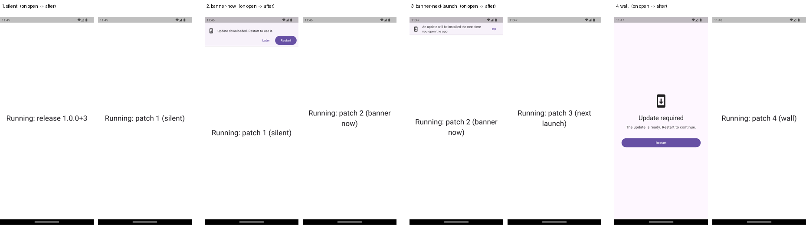

# shorebird_update_ui

Customizable Flutter widgets for code push updates. Each patch says how it
wants to be shown, set from the CLI with `--update-ui`, and your app's
`UpdateGate` acts on it:

| `--update-ui` | What the user sees | When the patch takes effect |
| --- | --- | --- |
| `silent` (default) | Nothing | Next launch (downloads in the background) |
| `banner-now` | Banner with **Update now** / **Restart** | Right away on Android; iOS asks the user to reopen |
| `banner-next-launch` | Banner: "installs the next time you open the app" | Next launch |
| `wall` | Blocking screen until the patch is installed | After **Restart** (Android) or reopening (iOS) |



A `wall` patch outranks gentler ones: a device that is behind the newest
`wall` patch sees the wall even if a later patch is `silent`.

This package is part of the [local-mode fork of Shorebird](../../LOCAL_MODE.md).
It reads the policy from the same host as the updater (`base_url` in
`shorebird.yaml`).

## Use it

```yaml
dependencies:
  shorebird_update_ui:
    git:
      url: https://github.com/mikemilla/shorebird
      ref: local-mode
      path: packages/shorebird_update_ui
```

```dart
MaterialApp(
  builder: (context, child) => UpdateGate(child: child!),
  home: const HomePage(),
);
```

Ship a patch with a style:

```sh
shorebird patch android --update-ui banner-now -d emulator-5554 --apply next-launch
shorebird patch ios --update-ui wall --all-devices
```

`--apply next-launch` leaves the app alone so its own UI handles the update.
The default, `--apply now`, relaunches the app for you, so you'll barely see a
banner. You can change an existing patch's style when re-pushing it:
`shorebird patches push --release-version 1.0.0+3 --update-ui wall -d <device>`.

## Customize it

Swap the visuals and keep the logic:

```dart
UpdateGate(
  bannerBuilder: (context, update) => MyBanner(
    text: update.phase == UpdatePhase.ready ? 'Restart to update' : 'Update',
    onTap: update.updateNow,
    onClose: update.dismiss,
  ),
  wallBuilder: (context, update) => MyBrandedWall(
    downloading: update.phase == UpdatePhase.downloading,
    onRestart: update.canRestart ? update.restart : null,
  ),
  child: child!,
)
```

Or keep the default widgets and just change the words:

```dart
UpdateGate(
  bannerBuilder: (context, update) => DefaultUpdateBanner(
    controller: update,
    strings: const UpdateStrings(available: 'New stuff is here!'),
  ),
  child: child!,
)
```

For full control, skip the gate and drive your own UI with an
`UpdateController`:

| Member | What it does |
| --- | --- |
| `check()` | Reads the policy and the updater's status. Silent, next-launch and wall updates start downloading. |
| `ui` | The `UpdateUi` style to show. |
| `phase` | `upToDate`, `available`, `downloading`, `ready`, or `failed`. |
| `showsBanner` / `showsWall` | Whether a banner or wall should be visible. |
| `updateNow()` | Downloads the patch, then restarts where possible. |
| `download()` / `restart()` | The two halves of `updateNow()`. |
| `dismiss()` | Hides the banner until the next check. The wall can't be dismissed. |
| `canRestart` | `true` on Android. iOS apps can't relaunch themselves. |
| `currentPatch` / `targetPatch` | The running patch and the incoming one. |

`UpdateGate(fallbackUi: ...)` sets the style used when the policy can't be
read. With local-mode pushes that is the normal case outside of a push, since
the CLI only answers while it's pushing.

## Things to know

- **Patches only take effect when the app starts.** Restart on Android relaunches
  the app in a fresh process (that's the plugin's native part). iOS has no
  supported way to relaunch an app, so the UI asks the user to reopen it.
- **With `auto_update` on** (the default), the updater often finishes
  downloading before the app checks, so `banner-now` usually opens on
  **Restart** rather than **Update now**. Set `auto_update: false` in
  `shorebird.yaml` to always start from **Update now**.
- The policy comes from `GET <base_url>/api/v1/patches/policy?app_id=&release_version=&platform=`,
  which returns `{latest_patch_number, update_ui, wall_patch_number}`.

## Example

[`example/`](example) is the demo app used to test all four styles on
Android emulators and an iPhone.
